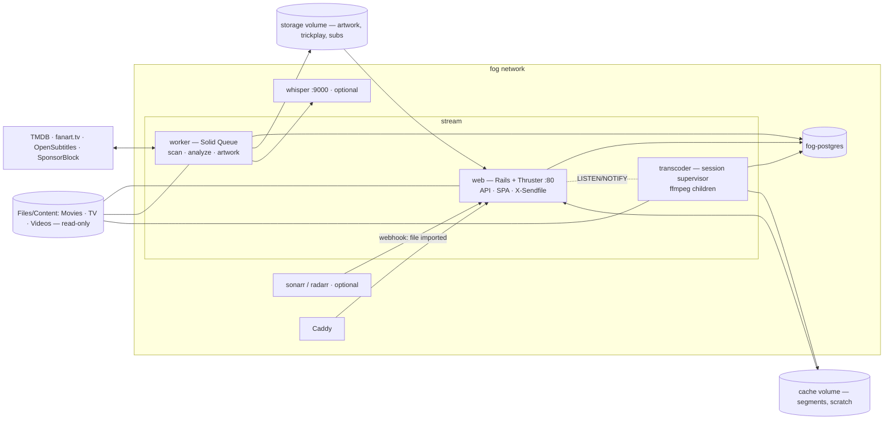

# Stream — Design Proposal

*v0.10, 2026-09-26. Status: in implementation — Phases 0–6 built (watch together left out); the fog deploy and the host benchmark remain; review decisions (§13) and spike results ([spikes.md](spikes.md)) folded in. Based on a survey of Plex, Jellyfin
and YouTube's viewing experience, the house stack (manor, hub, hook) and fog's
app/Files contracts. Citations use `hook:path`, `fog:path` for house code.*

**Stream is the household's video player.** It reads the video already on the
network — movies, shows, and everything that is neither (YouTube archives,
home videos, lectures, concerts, courses) — and plays it in the browser
instantly, at original quality whenever the browser can take it. It takes
Plex's polish, Jellyfin's openness, and YouTube's grammar for loose video, and
adds the thing none of them have: a playback engine that tells you *why* it
did what it did.

Three pillars, one loop:

1. **Library** — a local-first catalog that understands four shapes of video:
   *cinematic* (movies, collections), *episodic* (shows → seasons → episodes),
   *channel* (YouTube channels → videos, pulled by Stream itself) and *home
   video* (albums → clips, by date, from Immich). Files are identified by
   content, not path, so renames and reorganizations never lose history.
2. **Playback** — a decision engine that probes what *this* browser can decode
   and picks the cheapest path to a perfect picture: direct play → remux →
   audio-only transcode → video transcode, with every decision explained.
3. **Experience** — the parts you feel: skip intro/credits, trickplay scrubbing,
   up-next and binge flow, subscriptions feed, transcript search, a mini-player
   that follows you around the app, and a home screen that knows what you're
   in the middle of.

```
files on disk ──scan──▶ media file (fingerprint, probe, keyframes)
                              │
                         analysis pipeline ──▶ metadata · artwork · trickplay · markers · loudness · transcript
                              │
browser ──capabilities──▶ playback decision ──▶ direct play │ remux │ audio xcode │ video xcode
                              │
                         watch state ──▶ home hubs · next up · subscriptions · recommendations
```

## 0. North star — what Stream is exceptionally good at

Four things. Every feature must strengthen at least one:

1. **Press play, it plays.** Sub-second start on the LAN, instant seeks,
   original quality, zero buffering. Transcoding is a last resort, not a
   default, and when it happens it's because a specific stream in a specific
   file can't be decoded by a specific browser, and the player says so.
2. **Every kind of video gets a first-class home.** A two-hour film, the
   fourth season of a sitcom, and a 14-minute YouTube video essay each get
   the browsing and playback grammar that fits them. Nothing is dumped into
   an "Other Videos" library with a filename for a title.
3. **Viewing is effortless.** Intro skipped, recap skipped, next episode
   queued before the credits roll, subtitles that look like the author meant
   them to, dialogue you can hear without riding the volume, progress synced
   everywhere.
4. **Legible and reliable.** Every file shows what Stream knows about it and
   which analysis steps ran. Every playback session shows its decision tree.
   Nothing fails silently (hook's law, inherited whole).

Anything that serves none of these — acquisition (the arr stack and hook own
that; Stream only *asks* hook, §7.9), music (Navidrome), photos (Immich), broadcast TV (tuners, DVR) — is
out. Grid here (§7.7) is channels scheduled from the library itself;
the one live picture Stream relays is a stream an admin added by URL — a
camera on the LAN, a single web stream, a YouTube live stream or an MLB.tv
game (§7.8) — never a tuner or an IPTV list.

## 1. Goals and non-goals

**Goals**

- Everything Plex does for a home viewer on the LAN: libraries, rich
  metadata and artwork, collections, playlists, multiple household profiles,
  parental controls, watch state, continue watching / on deck, transcoding,
  subtitles and audio track selection, intro/credit skip, preview thumbnails,
  loudness levelling, extras (trailers, featurettes), and a Tautulli-grade
  activity/stats view.
- Jellyfin's openness: no accounts outside the house, local NFO/sidecar
  metadata honoured, Kodi/Jellyfin folder conventions understood, a
  documented API, watch-together (SyncPlay).
- YouTube's grammar for non-cinematic video: channels, subscriptions with a
  "new videos" feed, watch later, queues, chapters, hover-scrub thumbnails,
  playback speed, stats-for-nerds, sponsor/segment skipping for archived
  YouTube content, and search *inside* videos via transcripts.
- A client-agnostic API: the browser is the first client, but every
  playback decision is server-side and driven by a declared capability
  profile, so an Apple TV (tvOS, native HLS) client later is a new consumer,
  not a new backend.
- House-grade operations: fog manifest, `/up`, `fog-backup/2`, in-app
  settings, Sorbet strict, `bin/ci`.

**Non-goals (v1)**

- Apple TV / mobile native apps (API designed for them — §7.6, §11 Phase 6).
- Remote access beyond what fog already provides (LAN-first; fog's tunnel/VPN
  covers away-from-home).
- Acquiring movies and shows. Stream reads what Sonarr, Radarr and hook put
  down and listens to their webhooks. YouTube is the one source Stream pulls
  itself (§5.4). Search can *ask* hook for a title (§7.9); hook decides how
  and whether to get it.
- Music, photos, broadcast TV (tuners, DVR), a plugin marketplace. Stream's
  Grid (§7.7) airs the library, not the airwaves. Live streams (§7.8)
  are one URL at a time, added by an admin: cameras, single web streams,
  YouTube live and MLB.tv games; no tuners, no M3U lists, no EPG, no
  recording.
- Editing files on disk. Stream never writes into a media library (see §10).

## 2. The landscape and where Stream fits

| | Plex | Jellyfin | YouTube | **Stream** |
|---|---|---|---|---|
| Polish of the viewing UX | ★★★★ | ★★ | ★★★★★ | the bar is YouTube + Plex |
| Account/cloud dependency | plex.tv required for auth, discovery | none | n/a | none |
| Metadata | closed agents | open, pluggable, NFO | uploader-supplied | TMDB + NFO + yt-dlp `info.json`, frozen locally |
| Non-episodic video | "Other Videos" — a filename grid | "Home Videos" — same | native | first-class *channels* |
| Intro/credit skip | Plex Pass | plugin (intro-skipper) | chapters | built-in, per-show auto-skip preference |
| Why did it transcode? | buried in dashboard | buried in logs | n/a | admin page, plain language (§7.5) |
| Transcode strategy | on-demand, GPU-hungry | on-demand, GPU-hungry | pre-encoded ladders | direct-first, remux-cheap, pre-encode the rest |
| Search | titles/people | titles/people | titles + transcripts | titles, people, channels **and spoken words** |

**The opportunities (their pain points):**

- *Plex* keeps moving the home experience toward its own streaming catalog and
  ads, gates core features behind a pass, and depends on plex.tv for sign-in.
- *Jellyfin* is open and capable but its web client is dated, playback
  reasons are opaque, intro skip and trickplay were late plugins, and
  anything that isn't a movie or a show is a second-class citizen.
- *Both* default to on-demand transcoding, which is why they need a GPU. On a
  modern LAN with modern browsers most files never need a video transcode —
  they need a *remux* (container swap) and sometimes an *audio* transcode,
  both of which are nearly free on any CPU.
- *Neither* treats the growing pile of archived YouTube/creator content as
  what it is: channels, with uploaders, upload dates, descriptions, chapters,
  and sponsor segments.

**The niche:** a single-household, LAN-first player with YouTube-grade UX,
direct-first playback that runs happily on a CPU-only VM, three library
shapes, and radical legibility.

## 3. Architecture overview

### 3.1 Stack

The house stack, cloned from hook (the newest scaffold):

| Layer | Choice | Notes |
|---|---|---|
| Backend | Rails 8.1 / Ruby 3.4, API-only, Sorbet `typed: strict` | `/api/v1`; hook's `BaseController` (`finds`, `paginate`, `render_errors`), `T::Enum` + `ApplicationEnum`, house cops, `HouseholdScoped` |
| Jobs | Solid Queue, `config/recurring.yml` | separate queues: `scan`, `analyze`, `artwork`, `heavy` (trickplay, loudness, transcript, optimize), `default`; `limits_concurrency` per library and per file |
| Realtime | Solid Cable (Action Cable) | now-playing, scan progress, SyncPlay |
| DB | Postgres 18: `pg_trgm`, `citext`, `pgcrypto`, `pgvector`, `unaccent`; UUID PKs; string enums; jsonb probe/evidence | pgvector image as hook already uses (`hook:docker-compose.yml`) — for "more like this" |
| Media tooling | jellyfin-ffmpeg 7 (`ffmpeg`/`ffprobe`: absolute-tfdt fMP4 HLS, `tonemapx`, Intel QSV/VAAPI, chromaprint muxer, libwebp for artwork — Debian's 5.1 can't continue a remux timeline across restarts, spikes.md › B) | all invoked through `ToolRunner`: timeouts, stderr capture into `Activity`, never shell interpolation |
| Images | ffmpeg renders WebP at each kind's widths, plus a 24 px blurred WebP placeholder (inline data URI) and an average colour | signed URLs, served via X-Sendfile with immutable cache headers |
| Frontend | React 19 + TS + Vite 8 + Tailwind v4, TanStack Query v5, react-router 7, oxlint, vitest, Playwright | hook's `frontend/CLAUDE.md` rules verbatim: semantic tokens only, `ui/` primitives first, `QueryState` everywhere |
| Player | `hls.js` on MSE browsers, native HLS on Safari; custom React controls; JASSUB (libass→WASM) for ASS/SSA; a PGS renderer (libpgs-js) for image subs | we own the UI; no Video.js/Plyr skins |
| Tests | RSpec + webmock, simplecov ratchet, recorded TMDB fixtures, a **media fixture corpus** (tiny generated files covering every codec/container/subtitle case), Playwright playback tests in Chromium + WebKit | §8.4 |
| Deploy | fog git-source app, `stream.fog.yaml`, blue-green swap, `fog-backup/2` delegated | §9 |
| Errors | vendored `flare`, `fog-client` | inert without fog |
| Observability | vendored `lucid` (synced by `lucid:bin/sync-client .`): requests, SQL, jobs, runtime, profiles, logs, browser analytics to Lucid | inert without `LUCID_URL` + `LUCID_API_KEY` |

### 3.2 Topology



Three process types, one image:

- **web** — API, SPA, and *all* bytes to the browser. Rails only authorizes;
  Thruster serves the bytes via `X-Sendfile` (source files with Range support
  for direct play, segments from the cache volume, artwork). A Puma thread is
  held for milliseconds, never for the length of a movie.
- **worker** — Solid Queue: scanning, probing, matching, artwork, and the
  heavy analysis queue (trickplay, markers, loudness, transcripts, optimized
  versions) with a configurable "quiet hours" window.
- **transcoder** — a long-lived supervisor that owns ffmpeg child processes
  for live sessions. It is not a Solid Queue job: latency matters (a seek must
  restart ffmpeg in <300 ms), so web talks to it through Postgres
  `LISTEN/NOTIFY` on a `transcode_requests` channel, and segments land on the
  shared `cache` volume. Because session state is in Postgres and segments are
  on a shared volume, fog's blue-green swap of web replicas doesn't drop a
  playing session.

### 3.3 The playback contract

Browser media elements can't send `Authorization` headers (Safari's native
HLS especially). The house bearer-token pattern (`hook:ACCESS.md`) stays for
the API; media URLs carry a **stream token**: HMAC-signed, scoped to one
playback session + profile, 6-hour expiry, embedded in the path
(`/media/s/<token>/master.m3u8`, `/media/s/<token>/v0/seg-00042.m4s`). No
cookies, no CSRF surface, revocable by ending the session.

## 4. Data model

Tenancy is the house pattern: `Household` owns libraries and settings;
`User`s authenticate; **`Profile`** (new) is who is watching — a household
can have one login on the living-room browser and five profiles on it,
Netflix-style. All watch state hangs off `Profile`, not `User`.

### 4.1 Files — identity by content

- **`Library`** — kind (`movies` | `shows` | `channels` | `mixed`), root
  folders (validated `StorageLocation`s, hook §8), scan settings, metadata
  preferences (language, providers, prefer-local-NFO).
- **`MediaFile`** — path, size, mtime, **fingerprint** (OpenSubtitles-style
  hash: size + first/last 64 KiB — cheap, stable across moves), container,
  duration, overall bitrate, `probe` (jsonb, raw ffprobe), `keyframes`
  (int[] of pts — see §5.3), `state` (`discovered` → `probed` → `matched` →
  `ready` | `unmatched` | `missing` | `broken`), `missing_since`.
- **`MediaStream`** — per track: type, codec, profile, level, bit depth,
  resolution, frame rate, HDR format (HDR10/HDR10+/DV profile/HLG),
  channels/layout, language, title, default/forced flags. Queried directly by
  the decision engine; never re-probed at play time.
- **`Sidecar`** — external subtitles/NFO/images found beside a file.

A file that disappears is marked `missing`, not deleted; if a file with the
same fingerprint appears elsewhere within the grace window, it *moves*, and
every watch state, marker and analysis artefact moves with it. Deletion of
catalog rows happens only after a configurable grace period and is visible
in the activity log.

### 4.2 Catalog — three shapes

| Shape | Tables | Playable leaf |
|---|---|---|
| Cinematic | `Movie`, `Collection` (TMDB collections + manual + smart) | `Movie` |
| Episodic | `Show` → `Season` → `Episode` | `Episode` |
| Channel | `Channel` → `Video`, `ChannelPlaylist` | `Video` |
| Home video | `Album` → `Clip`, grouped by year and month | `Clip` |

Playable leaves share a `Playable` concern and link to one or more
`MediaFile`s through **`Edition`** (e.g. "4K HDR", "1080p", "Director's
Cut", "Extended") so versions of the same title collapse into one card with
a version picker, choosing the best one for the device by default.
`Extra` (trailer, featurette, deleted scene, behind-the-scenes) attaches to
a movie, show, or season.

Shared: `Person` + `Credit` (cast/crew with character + order), `Genre`,
`Tag`, `ExternalId` (tmdb, imdb, tvdb, youtube), `Artwork` (kind: poster,
backdrop, logo, still, profile, thumb; source; version; blurred placeholder and average colour).
Metadata edits by a person set a **lock** on the field so refreshes never
overwrite them (Plex's best idea).

### 4.3 Analysis artefacts

- **`AnalysisRun`** — one row per file per step (`probe`, `keyframes`,
  `match`, `artwork`, `trickplay`, `chapters`, `markers`, `loudness`,
  `subtitles`, `transcript`, `optimize`) with status, duration, error,
  tool version. The file page renders this as a checklist. A step re-runs
  when its input or tool version changes, never otherwise.
- **`Marker`** — `intro` | `recap` | `credits` | `preview` | `sponsor` |
  `selfpromo` | `interaction` | `chapter`, start/end, source (`detected`,
  `chapter`, `sponsorblock`, `manual`), confidence.
- **`TrickplayManifest`** — sprite sheet paths, tile interval, tile size.
- **`Loudness`** — integrated LUFS, true peak, LRA (EBU R128).
- **`TranscriptSegment`** — start, end, text, `tsvector`; source (embedded
  subs, sidecar, Whisper).
- **`OptimizedVersion`** — a pre-encoded rendition of a file that some
  target can't play (§5.5).

### 4.4 Viewing

- **`WatchState`** (profile × playable) — position, duration, `completed_at`,
  `play_count`, `last_watched_at`, `hidden_from_continue`. Rule: ≥ 90% or into
  the credits marker ⇒ completed; < 2 min ⇒ not started.
- **`ShowPreference`** (profile × show) — auto-skip intro/recap/credits,
  preferred audio/subtitle language, default playback speed (per channel too).
- **`Subscription`** (profile × channel), **`Queue`** (profile's
  up-next list, YouTube-style), **`Playlist`** (+ items; shared or private),
  `WatchLater` is a system playlist.
- **`PlaybackSession`** — profile, device, playable, media file, the full
  **decision** (jsonb: capability profile in, chosen path + per-stream
  reasons out), state, bitrate, transcode progress; **`PlaybackEvent`**
  (start/pause/seek/stop/error, buffer stalls) — the raw material for
  history, stats, and debugging.
- **`Device`** — a named browser/TV with its last capability profile and an
  optional **default profile**.
- **`ProfileTag`** (profile × movie, show, channel or album) — the allowlist
  for a curated profile; new episodes and videos inherit their parent's tag.
- **`PlaybackPreference`** (per profile) — up-next delay in seconds (0 =
  immediate), "Still watching?" limit or off, always skip intro and credits.

### 4.5 Platform

House: `Household`, `User`, `Session`, `ApiToken`, `Invite`, passkeys,
`Activity` (with `trace_id`), `JobRun`, `Setting`s with encrypted
credentials (TMDB key, OpenSubtitles login), `Notifier` (ntfy).

## 5. Pillar 1 — Library

### 5.1 Scanning

- **Full scan** walks roots, compares (path, size, mtime) against
  `MediaFile`, and enqueues per-file work for anything new or changed.
  Fan-out jobs only fan out (hook invariant 5).
- **Targeted scans**: Sonarr/Radarr "On Import/Upgrade/Rename/Delete"
  webhooks and a `POST /api/v1/libraries/:id/scan?path=` hook for yt-dlp
  post-processing scripts give "just added" in seconds.
- Media typically lives on a NAS share (fog's `Content` directory), so
  `inotify` will not see changes made on the NAS. Change detection relies on
  webhooks, the scan endpoint and Stream's own YouTube pulls, plus a look
  every 5 minutes at each root's folder mtimes (two levels deep for shows)
  that scans just the folders that moved once they've been quiet for two
  minutes — so files dropped in by hand arrive without a webhook. An hourly
  full scan is the safety net.
- Scanning never blocks on metadata: a file is browsable (with filename-
  derived title and a frame-grab thumb) as soon as it's probed.

### 5.2 Parsing and matching

- A Ruby release-name parser (guessit-style: title, year, `S01E02`,
  `1x02`, absolute numbering, date-based episodes, multi-episode files,
  edition tags, resolution/source/codec noise stripped) with a fixture suite
  of several hundred real filenames.
- Folder conventions understood: Plex/Jellyfin/Kodi naming, `{tmdb-123}` /
  `[imdbid-tt…]` hints in folder names, `Specials`/`Season 00`, `extras`
  subfolders (`Trailers/`, `Featurettes/`, `-trailer` suffix).
- Providers: **TMDB** (movies, TV, people, collections, images, trailers),
  optional **TVDB** for episode ordering (DVD/absolute orders for anime),
  **fanart.tv** for logos/clearart, local **NFO** + images first when the
  library prefers local. All through `UpstreamHttpClient` with circuit
  breaker; responses frozen into our tables — provider outage never blocks
  browsing or playback.
- Matching produces a score with reasons; below threshold the item lands in
  a **Needs match** queue with a one-click "Fix match" search (hook's
  `needs_review` pattern).

### 5.3 Probing and the keyframe index

ffprobe runs once per file; streams are normalized into `MediaStream`. A
second pass extracts the **keyframe index**, from the container's own index
when it has one (Matroska Cues, MP4 `stss` — a few KB read), falling back to
a packet-flag scan on the `heavy` queue (no decoding, but it reads the whole
file: minutes for a 30 GB remux over the NAS, spikes.md › B). This is the secret to instant remux seeking: the HLS
playlist for a remuxed stream is generated from real keyframe times, so
segment N always starts on a keyframe, the playlist is exact before ffmpeg
starts, and a seek maps directly to a segment without guessing (Jellyfin
10.9 adopted the same approach).

### 5.4 Channels — the YouTube layer

**Pulling from YouTube.** Tracking a channel takes one step: paste its URL
(`youtube.com/@handle`, `/channel/UC…` or `/c/name`) into **Add channel**.
Stream resolves it to the channel id, creates the `Channel` with its name,
avatar and banner, and starts a backfill. Defaults you can change per channel
before or after: how far back to fetch (all, last N videos or since a date),
keep last N, skip Shorts and livestreams, and max resolution. From then on the
channel is polled on a schedule and new uploads arrive on their own. Single
videos and playlist URLs work the same way. Downloads run on a bundled yt-dlp
worker on its own `youtube` queue: best format that direct-plays, plus `info.json`,
thumbnails and subtitles, landing in the channels library and the normal scan.

- **Sources of truth, in order:** yt-dlp `.info.json` (uploader, channel id,
  upload date, description, chapters, tags, thumbnails) → NFO → embedded
  container tags → folder structure (`Channel Name/Video.mkv`) → file
  creation date (home videos).
- **Hand-placed videos are identified.** A file dropped into a channel's
  folder with no info.json and no `[id]` in its name is looked up on the
  channel's own YouTube list (videos, streams and Shorts, one listing each):
  taken automatically only when its title is exactly the one yt-dlp would
  have named the file after (or nearly, at the same length) and its length
  agrees to within two seconds, with nothing else on the channel as close.
  Then its details, upload date and thumbnail are fetched from YouTube and
  kept on the video row, never written beside the file. Anything less sure
  shows its closest candidates under the description for an admin to pick,
  paste a link for, or mark "not on YouTube". A folder's channel learns its
  YouTube id from its first identified video, from **Link to YouTube** on
  its page (its channel link pasted: name, handle, pictures and description
  filled in, its videos looked up, nothing followed or downloaded), or from
  Add channel taking over a folder of its name; a tracked channel
  identifies before its first backfill, so what's already on disk isn't
  downloaded again.
- A **channel** has an avatar, banner, description, and a video grid sorted
  by upload date; a **video** has a YouTube-style watch page with
  description (links, timestamps clickable), chapters, and "more from this
  channel".
- **Subscriptions** give each profile a reverse-chronological "new videos"
  feed across channels, with unwatched dots — the YouTube home most people
  actually use.
- **SponsorBlock** (opt-in per library): segments fetched by YouTube id and
  frozen into `Marker`s; the player skips or offers to skip by category.
- **Home videos** are a separate shape, sourced from **Immich**: a read-only
  sync over Immich's API (with an API key) imports video assets with their
  capture date, albums, people and location. Pages group clips by year and
  month with a timeline scrubber; Immich albums become Stream albums, and
  faces become filters. Originals play from Immich's library, mounted
  read-only or streamed through its API. Home videos never mix into the
  subscriptions feed.

### 5.5 Analysis pipeline

Per file, after `probe` and `match`, on the worker's `heavy` queue, in
priority order (recently added and currently-watching shows first):

| Step | How | Why |
|---|---|---|
| Artwork | download chosen images, render WebP at 2–3 widths, blurred placeholder + average colour | instant, flicker-free grids |
| Trickplay | ffmpeg `fps=1/10`, 320 px tiles, 10×10 JPEG sprites (≈ 30 s CPU per hour of video) | hover-scrub previews on the seek bar and on cards |
| Chapters | from container, `info.json`, or description timestamps | chapter markers + chapter list |
| Intro/recap/credits | chromaprint the first 10 min and last 10 min of every episode in a season, find the shared audio run (intro), black-frame + silence + fingerprint for credits; movies: credits via black-frame/scene-change density near the end | skip buttons, "completed" accuracy, up-next timing |
| Loudness | ffmpeg `ebur128` measurement | *client-side* normalization via Web Audio `GainNode` — no transcode needed |
| Subtitles | embedded text subs → WebVTT/ASS extracted once and cached; missing languages fetched from OpenSubtitles (opt-in) | subtitles load instantly, never trigger a transcode |
| Transcript | subtitle text if present, otherwise the fog **Whisper** app (optional) for channels/home videos | transcript search, auto-generated captions |
| Optimize | only for files that *no* configured device can play without a video transcode (MPEG-2, VC-1, Hi10P H.264, HDR-only on SDR-only household) — encode an H.264/HEVC 1080p rendition in quiet hours | removes the live video transcode from the common path |

Every step writes an `AnalysisRun`. Failures follow hook's rules: record
`last_error`, never stamp success on failure, surface in the "needs
attention" panel.

Trickplay, loudness, the embedded subtitles and fonts, and the keyframe
index of a file whose container has none are made from **one read** of the
file (`Media::OnePass`, `AnalyzeMediaFileJob`): ffmpeg takes every output
from the same packets, so a remux on a slow share is read once, not four
times. A read stands still (SIGSTOP) while anyone is watching and goes on
when nobody is; a step whose output fails the read is left out of the next
one, and Needs attention says so, until it's asked for again.

## 6. Pillar 2 — Playback

### 6.1 Capability probing — never assume

On first load and when the display changes, the client builds a
**capability profile** using `MediaSource.isTypeSupported`,
`canPlayType`, and `navigator.mediaCapabilities.decodingInfo` for each
candidate (H.264 High/L5.1, HEVC Main/Main10, AV1 Main 8/10, VP9 profile
0/2; HDR10/HLG/Dolby Vision transfer functions; AAC, AC-3, E-AC-3, Opus,
FLAC, DTS, TrueHD at 2/6/8 channels), plus `screen` HDR support
(`matchMedia('(dynamic-range: high)')`), resolution, and whether
`smooth`/`powerEfficient` decode is reported. The profile is posted with
the playback request and cached on `Device`. A server-side table of known
browser quirks overrides where APIs lie (they occasionally do).

### 6.2 The decision engine

`POST /api/v1/playback/sessions { playable_id, edition_id?, profile, prefs }`
returns a session with URLs and a decision. Per stream, cheapest first:

1. **Direct play** — container + every selected stream supported → the
   original file via X-Sendfile with Range. Zero CPU.
2. **Remux / direct stream** — codecs fine, container not (MKV in Safari,
   AVI) → ffmpeg `-c copy` into fMP4 HLS using the keyframe index. ~1% of
   one core.
3. **Audio transcode** — video fine, audio not (DTS/TrueHD in most
   browsers, 7.1 on a stereo device) → copy video, encode AAC/Opus (or
   E-AC-3 5.1 where supported). A few % of one core.
4. **Video transcode** — codec unsupported, HDR on SDR display (tone-map),
   or explicit quality cap → H.264 (or HEVC if supported) via libx264/x265
   or a hardware encoder when present. Expensive — and the one case the
   optimize step (§5.5) exists to pre-empt.

Subtitles never force a transcode: text subs render client-side (WebVTT
natively, ASS/SSA via JASSUB with embedded fonts extracted), image subs
(PGS/VobSub) render client-side via a PGS renderer. Burn-in exists only as
a fallback for clients that can't render them (future TV client).

The decision is stored on the session and explained on the admin **Playback
decisions** page (§7.5), not in the player, for example: *"Remuxing: MKV isn't supported by Safari. Video
HEVC Main10 → copy. Audio TrueHD 7.1 → E-AC-3 5.1 (TrueHD not decodable
in this browser). Subtitles PGS → rendered in browser."*

### 6.3 The transcoder

- One ffmpeg child per live session (plus an optional prefetch child for
  the next episode's first segments during the credits of the current one).
- Remux cuts at **every keyframe**: ffmpeg runs `-c copy -copyts` into fMP4
  HLS with a tiny `hls_time` and `movflags=+frag_discont`, naming fragments
  by GOP index, so every run — whatever it restarted from — produces the same
  fragments with absolute timestamps and one shared init segment. Planned
  segment N (~6 s, fixed by the keyframe index) is served as the join of its
  GOP fragments. (ffmpeg's own `hls_time` cuts are cumulative from each run's
  start and drift after a restart; spikes.md › B.)
- Seeking: the client requests segment N; if its GOPs aren't cached and the
  running ffmpeg won't reach them within a few GOPs, the supervisor kills and
  restarts at N's first keyframe (`-ss` before `-i`, `-start_number` = that
  GOP). Measured: 0.2–0.4 s from seek to frame, Chrome and Safari.
- Throttling: ffmpeg's own `-readrate 2 -readrate_initial_burst 60` — the
  first 60 s (the web player's buffer goal; 30 s until 2026-10-05, which
  left half that buffer waiting on the throttle) arrive at disk speed so
  start and seeks are instant, then the run reads at twice real time, so a
  paused or abandoned session doesn't remux the whole film.
- AC-3/E-AC-3 into fMP4 always carries `movflags=+delay_moov`; software HDR
  tone-mapping uses jellyfin-ffmpeg's SIMD `tonemapx`, QSV's `vpp_qsv` on the
  iGPU.
- Cleanup: segment directories are deleted when the session ends or goes
  idle for 10 minutes; a janitor enforces a size cap on the `cache` volume.
- Concurrency: a household setting caps simultaneous *video* transcodes
  (default 1 in software; raised automatically when the probe finds a hardware
  encoder). Remux and audio sessions are not
  capped. When the cap is hit, the decision engine offers the optimized
  version or a lower-resolution transcode rather than failing.
- Hardware acceleration is an `Encoder` strategy (`software`, `qsv`,
  `vaapi`, `nvenc`, `videotoolbox`) chosen by a startup probe, so Stream uses
  whatever the host exposes and falls back to software. On an Intel iGPU
  QSV/VAAPI is the primary path: H.264 and HEVC 10-bit encode, with HDR tone-mapping on the GPU. Needs
  fog device passthrough (§9.3).

### 6.4 Performance targets (LAN, measured in Playwright + the stats panel)

| Metric | Target |
|---|---|
| Time to first frame — direct play | < 800 ms |
| Time to first frame — remux | < 1.5 s |
| Time to first frame — video transcode | < 3 s |
| Seek — direct / remux | < 400 ms / < 800 ms |
| Next episode start after up-next | < 500 ms (prefetched) |
| Home screen API p95 (10k-item library) | < 150 ms |
| Grid scroll | 60 fps, virtualized, blurred placeholders, no layout shift |
| Incremental scan, 10k files, no changes | < 30 s |

## 7. Pillar 3 — Experience

### 7.1 Home

Hubs, in an order the profile can rearrange:

- **Continue watching** — one row mixing movies, episodes and videos,
  most-recent first, with progress bars; dismissible per item.
- **Next up** — the next unwatched episode of every show you're in the
  middle of (Plex "On Deck").
- **New from your subscriptions** — channel videos since you last looked.
- **Recently added** per library, grouped ("4 new episodes of Severance")
  rather than one card per episode.
- **Because you watched…** / **More like this** — pgvector embeddings over
  genres, keywords, people, and overview text; no cloud.
- Pinned collections and playlists.
- A hero for the top continue-watching or newest item with its logo art and
  backdrop (a muted trailer loop is an opt-in).

### 7.2 Browse and detail pages

- Libraries as virtualized grids with sort/filter (unwatched, genre, year,
  resolution, HDR, audio format, added date) and saved **smart filters**
  that can become smart collections.
- Movie/show pages with logo art, backdrop, cast carousel, versions,
  extras, "watched/unwatched" toggles per season and episode, and a
  one-button **Play / Resume / Play next episode**.
- Person pages across all libraries.
- Channel and video pages as described in §5.4.
- **Command palette** (⌘K) and global search: titles, people, channels,
  collections, and **transcript hits** ("…said 'hyperloop' at 12:41 in
  *Video X*" — click jumps straight to that moment). `pg_trgm` for typo
  tolerance, `tsvector` for transcripts.

### 7.3 The player

Built for keyboards, mice and a couch alike.

- **Timeline**: trickplay previews on hover and while dragging; chapter
  ticks; intro/credits/sponsor segments tinted on the bar; buffered ranges.
- **Skip**: "Skip intro" / "Skip recap" / "Skip credits" buttons, with a
  per-show auto-skip preference ("always skip this intro") and per-category
  SponsorBlock behaviour (skip / ask / show only).
- **Up next**: at the credits marker (not a fixed countdown), a card with
  the next episode/video, a countdown (10 s by default, per profile down to
  0), and "watch credits"
  escape; binge mode offers "Still watching?" after 3 auto-plays.
- **Keyboard**: space/K, J/L ±10 s, ←/→ ±5 s, ↑/↓ volume, `,`/`.` frame
  step when paused, `<`/`>` speed, 0–9 seek to %, F fullscreen, C
  captions, M mute, I mini-player, `?` shortcut sheet.
- **Speed** 0.25×–3× with pitch preserved; per-channel default speed.
- **Audio**: track switcher with language + codec + channels;
  **loudness normalization** (default on, per profile); night mode
  (dynamic range compression via Web Audio `DynamicsCompressorNode`).
- **Subtitles**: track switcher, search-and-download from OpenSubtitles
  inline, sync offset ±, style (size, background, font) respecting ASS
  styling when present, and **dual subtitles** (two languages stacked —
  a language-learning favourite nobody ships).
- **Mini-player**: navigating away while playing collapses the player into
  a corner that keeps playing — YouTube's best trick, easy in an SPA with
  the player mounted above the router. Native Picture-in-Picture too.
- **Picture in picture of our own**: a second picture in an inset over
  the one playing — a camera over a film, a film over a Grid channel, any
  title, channel or stream over any other. It's chosen from the player's
  picture-in-picture button (cameras, channels on now, Continue watching)
  or beside Play anywhere while something plays (a title in the corner
  comes back over the page for it); it stays inside the main picture — a
  video in its page, scrolling with it, or clear of the Related panel —
  and drags by any part and resizes like the mini-player, and a title in it has the mini-player's rewind, play
  and skip. **Swap** (X) trades the two places without restarting
  either: a title keeps its player, a channel or camera is handed between
  its page and the inset still playing (as far behind live as it was).
  The sound is the main picture's, the inset's, or both — the inset starts
  silent, and the choice stays with its place across a swap. One picture
  floats at a time: the main title shrinking into the corner closes the
  inset. Stopping the main picture leaves the inset playing on its own.
- **Stats for nerds** overlay: decision, codecs, resolution, bitrate,
  buffer health, dropped frames, segment timings, transcoder speed.
- **Theater / fullscreen / ambient mode** (a blurred colour glow sampled
  from the frame around the video on dark themes).
- Progress reports every 10 s and on pause/seek/stop via `sendBeacon` so
  closing a tab never loses position.

### 7.4 Household

- **Profiles** with avatar and optional PIN; a profile picker on the TV-
  sized "who's watching" screen. **Default profile per device** (Settings ›
  Devices, or "make this the default here" from the picker): that device
  loads straight into the profile with no picker; switching is one tap on
  the avatar, and PIN-protected profiles still ask.
- **Kid profiles**: rating ceiling (per country certification), library
  allowlist, no access to settings; content without a rating is hidden
  unless explicitly allowed. **Curated mode** shows only items tagged for
  that profile: tag a show, movie, channel or album from its page or in bulk,
  and new episodes follow. **Playback overrides** per profile: up-next delay
  down to 0 s (the next Peppa Pig starts immediately, no countdown), always
  skip intro and credits, and "Still watching?" off or set to a limit.
- **Watch together** (SyncPlay): a room with a shared playhead over Action
  Cable; pause/seek/speed propagate; drift corrected by gentle rate nudges
  rather than hard seeks.
- **Activity** (Tautulli in the box): now playing with decisions and
  bandwidth, history, per-profile/per-library stats, most-watched, and a
  "transcode report" that lists the files forcing video transcodes and
  offers to optimize them.
- **Migrate from Plex** (Settings › Import), built so Plex and Stream can run
  side by side until cutover:
  1. **Connect:** point Stream at a Plex server (URL + token) or at a copy of
     its library database, read-only; nothing in Plex is changed.
  2. **Map people:** each Plex home user becomes a Stream profile, or merges
     into an existing one.
  3. **Dry run:** a report of matched, unmatched and conflicting items before
     anything is written; matching uses TMDB/IMDB/TVDB ids, then file
     fingerprints.
  4. **Import:** watched state, in-progress positions, play counts and
     last-watched dates, ratings, collections, playlists, and custom titles
     and posters (kept with field locks).
  5. **Keep in sync:** re-runs are idempotent and only pull changes, so
     anything watched in Plex during the transition shows up in Stream;
     unmatched items wait in the Needs match queue.

- **Trakt** (added 2026-09-27), per adult profile, opt-in — the one
  account outside the house Stream will talk to for a person, and only
  once they link it. An admin registers a Trakt API app once in Settings ›
  Integrations; each adult profile links its own Trakt account from
  Settings › Viewing with a device code (kid profiles never see it).
  Then:
  1. **Scrobbling:** worked out on the server from the players' progress
     reports — start on the first, stop when Stream counts the play
     watched (Trakt records it), pause on an early end or when reports
     stop. No client change; Grid doesn't scrobble.
  2. **Stream → Trakt:** marking watched/unwatched, offline and Grid
     plays, stars and Watch later go through an outbox
     (`trakt_changes`), sent in order, surviving a Trakt outage.
  3. **Trakt → Stream:** every 15 minutes, driven by `last_activities`:
     plays from other apps, resume points, stars, the watchlist. The newer
     view wins; a Trakt play within ten minutes of one Stream has is that
     play. Removals of stars and watchlist entries carry over both ways;
     unwatching on Trakt doesn't (Trakt keeps no time for it). Shows on
     the Trakt watchlist stay there — Watch later holds films and episodes.
  4. The first sync merges both sides. Titles are named by TMDB/IMDb/TVDB
     ids (episodes by show + season + number); YouTube, home videos and
     unmatched titles never reach Trakt.

### 7.5 Admin: Playback decisions

One admin page answers "why did it transcode?" at a glance; the player stays
clean.

- **Summary strip:** this week's split of direct play / remux / transcode,
  and the top three reasons for transcodes.
- **Session list,** newest first: title, profile, device, a coloured verdict
  badge (Direct · Remux · Transcode) and one plain-language reason, e.g.
  "Safari can't open MKV — repackaged, no quality loss".
- **Fix hint** per row when one exists: "Optimize this file" or "Enable HEVC
  on this device".
- **Filters** by verdict, profile, device and date; a row opens the per-file
  analysis page with the full codec-by-codec breakdown.
- Admins only; kid profiles never see it.

### 7.6 The API for future clients

- Everything the SPA does goes through `/api/v1`; no SPA-only endpoints.
- Playback negotiation is capability-profile driven (§6.1), so a tvOS
  client sends its own profile (HEVC, Dolby Vision, E-AC-3/Atmos passthrough
  via native AVPlayer HLS) and gets the same decision engine.
- **Device-code pairing** (`POST /api/v1/device_codes` → "enter ABCD-1234 at
  stream.<domain>/link") for TVs without keyboards; designed in Phase 5,
  consumed by the Apple TV client later.
- OpenAPI via rswag (as manor) so a Swift client can be generated.

### 7.7 Grid — channels made from the library

Numbered channels that air the household's own shows and films on a fixed
schedule, a DirecTV-style guide, and channel surfing: the feeling of
turning the TV on and seeing what's on, with nothing but the library.

- **Stations** (named so because YouTube owns `Channel`): a number (`4`,
  `4.1`), a name, a grid the starts snap to, and how long before a shuffled
  program may repeat.
- **Blocks** program them in layers; for any minute the highest layer
  covering it decides. A *special* (between two dates) over an
  *appointment* (a fixed slot — Breaking Bad, Sundays at 8) over a
  *daypart* (weekday mornings, primetime) over the *base* mix. Specials and
  appointments start on the dot and own their slot: what airs before one is
  chosen to end in time, and a gap is a slate. A daypart waits for what's
  on to finish.
- Each block draws from rules — picked shows, films and collections; YouTube
  channels (each one a series, in upload order; a video answers only
  channel, library, upload year and length, and counts as unrated); every
  network a show aired on and the studios behind a film (TMDB's); genres
  and keywords, in and out; years (an episode's own air date); rating
  floor and ceiling; length; unwatched (nothing any profile — or any of
  the chosen ones — has finished, read as each plan is made, so what's
  seen leaves from the next night's schedule) — in an **ordering**: shuffled (not repeated
  within the channel's window), in order, rotating shows like syndication,
  marathons, or by original air date. Cursors ("Breaking Bad is up to
  S2E4") are read from the airings themselves, so a rebuild that drops the
  future rolls them back with it.
- **Teams' games.** Once the household has MLB.tv (§7.8), a channel can
  carry clubs (`mlb_team_ids`, in order): whenever one plays, the game is
  on, over every layer, from first pitch back to the quarter hour for
  three hours, as an airing of the team's stream with no file (its
  `mlb_game_pk`, and the matchup — "Cubs at Brewers", a playoff game's
  series — as its title). The broadcast is the first-listed team's, and
  two of its teams playing at once air the first one's game. The slot is
  a guess that a job keeps true every minute (`Stations::Games.follow!`):
  a game that's over ends its slot there, one in extra innings is given
  half an hour more at a time, and a schedule that changed — postponed,
  rescheduled, a playoff game added — rebuilds what hasn't started. A
  game is tuned in as its stream with the airing's slot, so the player
  moves on to what follows when the slot ends, as it does for any program.
- **The scheduler** is deterministic (seeded by channel, block and moment)
  and only appends; a nightly job keeps every channel three days ahead.
  Saving a channel rebuilds from the end of the program on now. Airings pin
  the file and use its probed length; the household's time zone
  (Settings › General) says what 8pm means, through daylight saving.
- **One lineup per household.** A restricted profile sees a channel only
  while everything scheduled on it is something it may see
  (`Viewing::Access.stations`), and any profile can hide a channel.
- **Tuning in** is a playback session like any other, through the unchanged
  decision engine, with the airing's file and the server's idea of where
  live is. Pause and rewind work within a program (the player says how far
  behind live), **Restart** goes back to its start, **Jump to live**
  catches up; nothing plays ahead of live. Watching live marks a program
  watched once seen to the end having seen half of it, and never makes a
  Continue watching card.

### 7.8 Live streams — a URL that plays like a title

A camera on the LAN, a single web stream (HLS or DASH), a YouTube live
stream or an MLB.tv game, added once by an
admin and then pressed play on like a movie: a card in a **Live** library,
and, if pinned, a number in the Grid guide.

- **`LiveStream`** is a playable in a library of the new `live` kind: a
  name, a kind (`camera` | `web` | `youtube` | `mlb`), the URL (`encrypts`-ed and never
  serialized back: a camera's secret is its credentials or, for UniFi
  Protect's `rtsps://<nvr>:7441/<token>?enableSrtp`, the path itself), whether
  to trust the source's own certificate (a camera's is self-signed), a
  rating, artwork (a
  chosen image, or the latest still), and a status (`online` | `offline`
  with `last_error` and when it was last seen). Admins add and edit them in
  the live library's own page, and a URL saves only after a `test_connection`
  that probes it. `Viewing::Access` governs it like any title: its library,
  its rating, curated tags. It has no watch state, no Continue watching and
  no Trakt.
- **Probe on save, decide from rows.** The probe (ffprobe on the URL, a few
  seconds' timeout) leaves an `AnalysisRun` and stores the stream's tracks
  as rows the decision engine reads, exactly as a file's would be; play
  never probes. A camera that changes codec is re-probed when its relay
  fails to start, and that failure is recorded, not swallowed.
- **Always relayed.** The browser never opens the URL: `http` on an `https`
  page is mixed content, RTSP and MPEG-TS don't play in a browser, and most
  web streams send no CORS headers. A **relay** — one ffmpeg per stream and
  per decision, shared by everyone watching it — pulls the URL and writes a
  sliding-window live fMP4 HLS playlist into `cache`, served under
  `/media/s/<token>/` through Thruster like any segment. It starts on the
  first viewer, stops a minute after the last, and is restarted with
  backoff when the source drops, the player saying "reconnecting" rather
  than ending. Cameras usually allow a handful of connections; sharing the
  relay is what keeps the household from using them up. A stream can be
  **kept connected**: one relay runs all the time (copying whatever the
  picture is), so pressing play joins it at once rather than waiting for
  the camera's next keyframe — new cameras start kept connected.
- **Direct first still holds**, per stream: video copied whenever the
  client can decode it (a camera's H.264 nearly always; its HEVC where the
  capability profile says so), camera audio (G.711, AAC-LC at odd rates) to
  AAC, and a video transcode only for what no client path can play, with
  its reason on Playback decisions like any other.
- **The player** is the Grid player without a schedule: a LIVE badge,
  pause and rewind within the relay's window (a few minutes), Jump to live,
  no duration, no Up next. Cameras ask for short segments so the picture
  is seconds behind, not tens of seconds.
- **In the guide**, a station may be pinned to a live stream instead of
  blocks: one program, the stream's name, all day; tuning, standby and
  channel changes work as for any station.
- **Legibility.** A stream that's offline shows it on its card and, after
  repeated failures, in Needs attention; the relay's ffmpeg log is kept for
  the session with the URL reduced to scheme, host and port everywhere it
  appears — logs, `last_error`, Playback decisions, `JobRun`s.
- **YouTube live, by its link.** A `youtube` stream keeps the link
  `Youtube::Urls` rebuilds from the id — a video's, or a channel's
  `/live` page, which follows the channel's stream across the new ids
  YouTube gives a restarted one (a playlist is refused). The link is no
  secret and is the stream's `source`. yt-dlp (`--match-filter is_live`)
  turns it into YouTube's HLS playlists, the picture's and the sound's
  apart, read as two inputs; a video that isn't live says so. Those
  playlists expire in six hours, so they're cached until half an hour
  before, shared by the probe, the stills and the relay, and asked for
  again whenever a relay fails; the transcoder asks on a thread of its own,
  so its loop never waits on yt-dlp. A googlevideo address never reaches a
  log or `last_error`.
- **MLB.tv games, by their link.** An `mlb` stream keeps the game's link
  `Mlb::Urls` rebuilds from its number (`mlb.com/tv/g<gamePk>`), and which
  team's broadcast it plays (`feed`: `home` | `away`). The household's
  MLB.tv account is set in Settings › Integrations (`MlbSetting`, the
  password encrypted and write-only, tested by signing in) and reaches
  yt-dlp as a netrc file that exists only while yt-dlp runs, never on its
  command line. yt-dlp's MLB.tv extractor lists every broadcast of the
  game; `LiveStreams::MlbSource` picks one from what each format is — the
  chosen feed's TV broadcast, else the other's, else a national one;
  English; the highest bitrate; never radio — because the format names'
  case and shape have changed between yt-dlp versions. A game that isn't
  on, a blackout and a refused sign-in each say so. The playlists carry a
  token of unknown life, so they're kept twenty minutes and forgotten
  whenever a relay fails, like YouTube's (both go through
  `LiveStreams::Resolver`).
- **Baseball: games from MLB's schedule, played as team streams.** Once
  the account is saved, every profile gets Baseball in the sidebar: a day
  of games from MLB's public Stats API (`Mlb::Schedule`, cached 15 s while
  a game is on, five minutes otherwise; logos hotlinked from MLB's CDN as
  TMDB's posters are) shown as a scoreboard — score, inning, count, outs,
  bases, line score, probable and deciding pitchers, series. A game plays
  as the stream of the team whose broadcast was chosen: one `LiveStream`
  per club (`mlb_team_id`, no library, no link), made for every club when
  the account is saved (`Mlb::TeamStreams`). At relay time it finds the
  game that team is on now and plays the team's side of it, so it is an
  ordinary stream everywhere — the full-screen player, picture in picture
  ("Baseball now"), a Grid channel that shows the team's games as
  they're played, and a channel that carries teams' games between its
  programming (§7.7). It is read (probed) the first time it plays and again
  after a game went off. Team streams are kept out of Settings › Live
  streams, the five-minute stills and Needs attention, and any profile may
  play one: MLB rates nothing. A pasted game link still works.
- **Basketball: the NBA's schedule, watched on NBA.com.** NBA League Pass
  games are DRM-protected (Widevine/FairPlay) and yt-dlp has no working
  NBA extractor, so Stream can't relay them and doesn't try: it keeps no
  NBA account. Turning League Pass on in Settings › Integrations
  (`NbaSetting`, nothing to fill in; Test reads the schedule) puts
  Basketball in the sidebar, the same scoreboard as Baseball — score,
  quarter and clock, records, line score with overtimes, top scorers,
  playoff series, broadcasts — from ESPN's public scoreboard
  (`Nba::Schedule`, one request a day gives its games and the season's game
  days; cached 15 s while a game is on). NBA.com's own feed turns away
  anything that isn't a browser. A game's link opens the day's games on
  NBA.com, where League Pass plays it live or as a replay; ESPN doesn't
  carry NBA.com's game id, so it can't open the game itself. No team
  streams, picture in picture or Grid channels.
- **Cameras speak RTSP over TCP.** The relay asks for interleaved TCP
  (`-rtsp_transport tcp`), so `rtsps` with `?enableSrtp` works as it is and
  nothing needs UDP ports through Docker. Certificates are verified unless
  the stream trusts its own (then `-tls_verify 0`, passed explicitly:
  ffmpeg 9 verifies by default, jellyfin-ffmpeg 7.1 doesn't and ignores the
  option). A probe that fails verification says so and offers the switch.
- **Latency follows the camera's keyframes.** Copied video can only be cut
  at a keyframe, so the camera's keyframe interval (UniFi's default is
  5 s) sets segment length and how far behind live the picture is. The
  stream's page says so, and suggests the camera's own setting before any
  re-encode.

### 7.9 Asking Hook — the library's next shelf

Search is where a person finds out Stream doesn't have something, so search
is where they ask for it. With hook connected (fog's Integrations tab:
hook's **Library** offer sets `HOOK_URL` and `HOOK_API_TOKEN`, a token that
may read and ask but manage nothing — `hook:ACCESS.md` › Another app on the
box), the ⌘K palette looks further:

- **The telescope** at the right of the search field, **⇧↵**, or the last
  row of Stream's own results ("Look for "x" in Hook") searches the same
  words through hook — films and shows, from TMDB. The mode is the palette's,
  not a page: the field keeps its words, the icon stays lit, Esc returns to
  Stream's results.
- **What Stream already has says so.** A hit whose TMDB id is in a library
  this profile sees (`Viewing::Access`) is badged *In Stream* and opens
  there; a film hook already wants is *Requested*.
- **A film** is requested with Enter (or a click) — a want under hook's
  default film profile. The row becomes *Requested* (*not out yet* when
  hook is waiting on a release).
- **A show** opens in place. Opening it adds the show to hook's catalog
  (as hook's own console does) and lists its seasons, each counted against
  what Stream already plays: *In Stream* and *Requested* seasons are
  settled; the rest say what's missing ("3 of 8 in Stream", "Airs 6 Nov").
  Choose any number of seasons, and optionally **follow** the show so new
  episodes come as they air — *only episodes from today on* by default,
  since the seasons already aired are the ones just chosen; unchecked, hook's
  *Everything* preset. One button asks for all of it ("Request 2 seasons and
  follow").

Every call names the person in `Hook-On-Behalf-Of`, so the want is theirs
in hook — or, when hook doesn't know their email, says it was asked for
them in Stream. Guests and kid profiles watch; they don't ask. hook's
refusals are shown in its own words, and each request is an Activity line.
Settings › Integrations shows whether hook is connected, and its Test says
who hook takes the asker to be. What arrives comes the usual way: hook
delivers into a library and tells Stream (§5.1).

## 8. Cross-cutting

### 8.1 Auth

House pattern (hook `ACCESS.md`): setup wizard creates the household and
admin; email+password and passkeys; bearer session tokens; API tokens for
scripts; `/up` unauthenticated. Profiles sit *inside* a signed-in session.
Stream tokens (§3.3) for media bytes.

### 8.2 Legibility

- Per-file page: path(s), streams table, every `AnalysisRun` with its
  status and a Re-run button, markers with a timeline editor for manual
  correction.
- Per-session decision (§6.2), stored for history.
- Activity log with trace ids across web → worker → transcoder.
- A **Needs attention** panel: unmatched files, broken files (probe
  failed), missing roots, failed analysis steps, transcode-forcing files,
  provider circuit breakers open.

### 8.3 Frontend platform

hook's `frontend/CLAUDE.md` wholesale: semantic tokens only with
`bin/design-guard`, `ui/` primitives before pages, `LoadingState`/
`ErrorState`/`EmptyState`, query keys from `lib/queryKeys.ts`, derived
unions mirroring backend enums. Stream adds:

- A **dark-first cinematic theme** (the app is watched in dark rooms) with
  a light theme as a token override, not a fork.
- A **10-foot mode** (`/tv` layout): large type, D-pad/arrow-key spatial
  navigation, focus rings sized for a couch — lets a browser on a TV or a
  mini-PC work today and prototypes the Apple TV information architecture.
- Route-level code splitting; the player bundle (hls.js, JASSUB WASM) loads
  on intent (hover on Play), not on first paint.

### 8.4 Testing

- **Media fixture corpus**: `spec/fixtures/media/` generated by a script
  with ffmpeg (`lavfi` test sources, a few seconds each): every container
  (MP4, MKV, WebM, AVI, TS), codec (H.264 8/10-bit, HEVC, AV1, VP9,
  MPEG-2), audio (AAC, AC-3, E-AC-3, DTS, TrueHD, FLAC, Opus), subtitle
  kind (SRT, ASS, PGS, mov_text), HDR metadata, broken/truncated files.
  Tiny, committed, deterministic.
- Decision-engine table tests: (file streams × capability profile) →
  expected path and reasons.
- Parser fixture suite of real-world filenames.
- Playwright: play, seek, switch audio, switch subs, skip intro, up next
  — in Chromium **and** WebKit, against the fixture corpus.
- webmock always; recorded TMDB/OpenSubtitles/SponsorBlock fixtures.

## 9. Fog integration

### 9.1 App declaration (sketch)

```yaml
name: stream
spec:
  source: { type: git, repo: https://github.com/fogapp/stream.git, branch: main, dockerfile: Dockerfile }
  env: { RAILS_ENV: production, GIT_SHA: "{{commit}}", STREAM_HOST: "{{fqdn}}", JOB_CONCURRENCY: "2" }
  secrets: [SECRET_KEY_BASE, AR_ENCRYPTION_PRIMARY_KEY, AR_ENCRYPTION_DETERMINISTIC_KEY, AR_ENCRYPTION_KEY_DERIVATION_SALT, STREAM_TOKEN_KEY]
  needs:
    postgres:
      databases: [stream_production, stream_production_cache, stream_production_queue, stream_production_cable]
      extensions: [pg_trgm, citext, pgcrypto, vector, unaccent]
  release: [./bin/rails, fog:release]
  processes:
    - { name: worker, command: ["./bin/jobs"] }
    - { name: transcoder, command: ["./bin/transcoder"] }
  volumes:
    - { name: storage, mount: /rails/storage }          # artwork, trickplay, extracted subs — backed up
    - { name: cache, mount: /cache }                     # HLS segments, scratch — never backed up
    - { name: movies, mount: /media/movies, files: Content/Movies }   # read-only in spirit (§10)
    - { name: tv, mount: /media/tv, files: Content/TV }
    - { name: videos, mount: /media/videos, files: Content/Videos }
  routes: [{ port: 80 }]
  health: { path: /up }
  deployStrategy: swap
  backup: { enabled: true, beforeUpdate: true, mode: delegated }
  memoryLimit: 3g
```

Which folder is which library is configured in Settings › Libraries
(validated paths), never assumed from mount names — hook's rule.

### 9.2 Backups

`fog-backup/2` delegated: the database (catalog, watch state, markers,
edits, settings) is the precious part. `storage` (artwork, trickplay) is
regenerable but slow to rebuild, so it rides along; `cache` never does.
The media itself is not part of Stream's backup.

### 9.3 What fog needs to grow (dependencies, not blockers)

- **CPU type.** A VM with a generic virtual CPU such as `kvm64` has no
  AVX/AVX2, and x264/x265 fall back to
  scalar paths and are several times slower; some prebuilt ffmpeg binaries
  may not run at all. Phase 0 includes building/verifying ffmpeg for the
  baseline ISA; setting the VM's CPU type to `host` is a one-line change
  that would materially improve any transcode.
- **Device passthrough.** A host with an iGPU passed through to it needs
  fog to hand the device on. `AppSpec` has no
  `devices` field today
  (`fog:docs/PROPOSAL.md` §7 lists GPU scheduling as out of scope). Hardware
  transcode needs `/dev/dri` (Intel QSV/VAAPI) passed to the `transcoder`
  process — a small fog change. Until then Stream runs in software and
  switches to QSV/VAAPI automatically once the device appears.
- Stream works fully without either; the direct-first design (§6.2) and
  optimized versions (§5.5) are what make that true.

## 10. Security and safety posture

- **Read-only toward media.** Stream never writes, renames or deletes in a
  library root. Artwork, extracted subtitles, NFO edits and trickplay live in
  `storage`. (A future "write NFO back" option would be explicit and off.)
- Paths from the client are never trusted: every file served is resolved
  from a `MediaFile` id and checked to be under a configured root after
  `realpath` — no traversal via symlinks.
- ffmpeg is invoked with argv arrays only, with `-protocol_whitelist
  file,pipe` so a crafted playlist in a library can't make ffmpeg fetch URLs.
- A live stream's relay is the one ffmpeg input from an admin-entered URL
  (§7.8): its own `FfmpegArgs::Input`, whitelisting only what the URL's
  scheme needs (`http,https,tcp,tls,crypto` for HLS/DASH,
  `rtsp,rtsps,tls,tcp,rtp,srtp,udp` for a camera) and never `file`, so a remote playlist
  can't point ffmpeg at the local disk. Private addresses are allowed —
  cameras live there — because only an admin can enter the URL.
- Stream tokens are HMAC-signed, session-scoped, expiring; the stream token
  key is its own secret so rotating it ends all sessions without logging
  anyone out.
- Upstream egress only via `UpstreamHttpClient`; credentials `encrypts`-ed
  and never serialized back.

## 11. Implementation plan

Each phase ships something usable and ends deployed via fog.

**Phase 0 — Skeleton + spikes** *(built 2026-09-25; spikes.md)*
Clone hook's scaffold (Rails 8.1 API + SPA, Sorbet strict + tapioca
compilers, house cops, `BaseController`, serializers, enums, `HouseholdScoped`,
auth + setup wizard, `Activity`, `JobRun`, `UpstreamHttpClient`, console
platform, `CLAUDE.md` + `frontend/CLAUDE.md`, `bin/ci`, Dockerfile, fog
backup contract, `stream.fog.yaml`). Dev ports: Postgres **5437**, Rails
**3003**, Vite **5177**. Add ffmpeg/fpcalc/vips to the image and the media
fixture corpus generator. **Spikes** (throwaway, results written into
`docs/spikes.md`): Thruster X-Sendfile + Range for multi-GB files;
keyframe-indexed fMP4 HLS remux playing in Chrome + Safari with instant
seek; ffmpeg speed on the fog VM's CPU.
*Exit: logged-in empty app at `stream.<domain>`; a hard-coded MKV plays via
remux in Safari and seeks instantly.*

**Phase 1 — Library + direct play (daily-drivable for movies)** *(built
2026-09-25 in eight slices, each green in `bin/ci` and pushed; deviations:
artwork placeholders are blurred WebP data URIs rather than ThumbHash, ffmpeg
renders artwork so libvips is gone, and subtitle/audio track switching moves
to Phase 2 with the subtitle pipeline. Plex import is untested against a real
server.)*
`Library`, roots + validation, scanner (full + targeted), `MediaFile` +
fingerprint + probe + `MediaStream` + keyframes, parser, TMDB adapter,
movie/show/season/episode matching with Needs-match queue, artwork pipeline
(sizes + blurred placeholders), browse grids, detail pages, `Profile` (single default),
`WatchState`, continue watching, the player v1 on hls.js (play/pause/seek,
audio/subtitle text tracks, keyboard basics), direct play only, Sonarr/
Radarr webhooks. **Plex migration, part 1:** connect, profile mapping,
dry-run report, and import of watched state, positions and play history,
with delta re-sync.
*Exit: your Movies and TV folders browse beautifully; anything the browser
can direct-play resumes where you left off.*

**Phase 2 — Playback engine (everything plays)** *(built 2026-09-25; exit
met: every file in the fixture corpus plays in real Chrome and in WebKit,
`frontend/e2e/playback.spec.ts`. Deviations: at the video-conversion cap,
Play explains and refuses rather than offering a lower resolution, since
optimized versions are Phase 6; the VA-API encoder path (an Intel
iGPU) is written but untested until fog passes `/dev/dri` through, and QSV is
left out because VA-API covers the same iGPU; VobSub and DVB subtitles
aren't offered, since browsers can't render them and burn-in waits for
the TV client; PGS rendering has no fixture, since ffmpeg can't encode PGS;
the media playlist is served without a master playlist; next-episode
prefetch moves to Phase 3 with Up next.)*
Capability probe, decision engine with reasons, stream tokens, transcoder
process with LISTEN/NOTIFY, remux + audio transcode + video transcode, seek
restart, throttling, cache janitor, concurrency cap, subtitle pipeline
(extraction, JASSUB, PGS renderer), admin Playback decisions page, stats-for-nerds,
`PlaybackSession`/`PlaybackEvent`, per-file analysis page, decision-table
and Playwright playback suites in Chromium + WebKit.
*Exit: every file in the library plays in Chrome and Safari; the transcode
report shows exactly which files need a video transcode and why.*

**Phase 3 — The experience (better than Plex)** *(built 2026-09-25; the
exit is the household's call once it's deployed. Deviations: recaps are
found only from chapter names, not by audio matching; frame-step assumes
24 fps; volume levelling and night mode use Web Audio, which starts only
after a gesture and never on Safari's native HLS, so there a loud file can
only be turned down; search covers titles, episodes, people and
collections, with channels and transcript hits waiting for Phase 4; home
has no pinned collections or playlists, "Because you watched" or trailer
hero yet; extras come from files only (no TMDB trailers); the version
picker is on movies, not episodes; collections are household-wide rather
than per library, and only admins edit them or metadata; posters can be
brought from Plex but not chosen or uploaded in Stream; ratings are rated
in the UI on movies and shows (episodes only arrive from Plex);
**playlists were pulled forward from Phase 4** so Plex's could be
imported, and are per profile; smart Plex collections and playlists are
saved filters and are skipped. The Plex import has still never run
against a real server.)*
Trickplay, chapters, intro/recap/credits detection + skip + per-show
auto-skip, up next at the credits marker with next-episode prefetch, binge
mode, loudness normalization + night mode, mini-player, full keyboard map,
speed, home hubs (continue watching, next up, recently added grouped),
command palette + search, Extras and Editions, collections (TMDB + manual),
metadata editing with field locks. **Plex migration, part 2:** ratings,
collections, playlists, and custom titles and posters with field locks.
*Exit: you stop opening Plex.*

**Phase 4 — Channels (the YouTube layer)** *(built 2026-09-25; the exit
is the household's call once it's deployed. Deviations: YouTube downloads
are the one exception to "never write into a library root" — a single
folder chosen in Settings › YouTube, with keep-last deleting only Stream's
own downloads; yt-dlp is only ever given URLs rebuilt from validated ids;
yt-dlp and Deno (YouTube now needs a JS runtime) are baked into the image
and yt-dlp self-updates into storage; no cookies, so members-only and
age-restricted videos fail with their reason; Shorts and livestreams are
skipped by leaving out those channel tabs plus a live-status filter.
Subscriptions are per profile and separate from an admin's "follow"
(which is about downloading); the play-next queue lives in the browser
tab. SponsorBlock choices are per profile in a new Settings › Viewing tab
(pulled forward from Phase 5). Transcripts use English stemming for
search; Whisper covers channel and home videos without subtitles (fog's
whisper-asr-webservice or any OpenAI-compatible server) and its output is
also offered as auto-generated captions. Home videos play from their
folders — a Home videos library over the same originals Immich has,
mounted read-only — not streamed through Immich's API; Immich's sync
matches by path through a configurable mapping and brings people, places,
capture times (kept as wall clocks), descriptions, favourites and albums.
Places are text (city, country): no map yet.)*
YouTube pull (channel URL → tracked channel, backfill, scheduled polling
with retention rules, yt-dlp worker and updates); `channels` library kind,
`Channel`/`Video`, yt-dlp `info.json` + NFO + folder sources; `home_videos`
library kind with `Album` and `Clip`, date-grouped pages, and Immich sync of
video assets, albums and people; channel and watch pages, subscriptions feed,
watch later + queues + playlists, clickable description timestamps,
SponsorBlock, OpenSubtitles fetch, transcripts (subs + optional Whisper) and
transcript search.
*Exit: your YouTube archive and home videos feel like YouTube, minus the
algorithm and the ads — and you can search what was said.*

**Phase 5 — Household** *(built 2026-09-25; the exit is the household's
to judge once it's deployed. Deviations: a profile is chosen with a
server-signed token (X-Stream-Profile) minted only after its PIN; a
device's default profile loads without asking, as a trusted device;
without either, the first profile without a PIN. Kid limits are enforced
in one place (Viewing::Access) for every read; channels and home videos
carry no rating, so under a ceiling they need "unrated allowed" or a tag;
albums can be tagged through the API but not yet from a page.
Recommendations are feature-hashed vectors of genres, people, series,
decade and overview words in pgvector — no embedding model — giving More
like this and Because you watched (no taste-centroid row yet). Smart
collections come from a rules form rather than a library's saved
filter. Stats are admins-only, with bitrate from the file (not measured on
the wire). ntfy goes to a topic per profile, a season batched into one
message. The /tv layout covers Home, movie and show pages and playback —
no search or library browsing on the TV yet — and uses the regular player.
Pairing is /api/v1/pairings (the plan said device_codes). The OpenAPI
document covers what a client needs to sign in, choose a profile, browse
and play, not every admin endpoint. Watch together (SyncPlay) is not
built.)*
Multiple profiles with PINs and the picker, per-device default profile,
kid profiles with rating ceilings, curated tag-only mode and per-profile
autoplay settings, recommendations (pgvector), smart collections, Activity/stats
dashboard, notifications (ntfy: "new episode of X"), 10-foot `/tv` layout
with spatial navigation, device-code pairing, rswag OpenAPI.
*Exit: the whole household uses it, each with their own state, on laptops
and a TV browser.*

**Phase 6 — Beyond** *(built 2026-09-26 in five slices, without watch
together, which the household won't use. Deviations: optimized versions
are H.264 SDR MP4 with one stereo AAC track (the file's default), kept on
the `cache` volume within a space budget (they can always be made again),
and encoded by the transcoder process itself in quiet hours, giving way to
any live conversion — a version gives its attempt back and starts over
rather than failing; the decision engine plays one as a new `optimized`
method, only where the original would need its video converted and only
for its own audio track, which also keeps it out of the conversion cap.
Remote transcode workers talk HTTP rather than sharing Postgres and the
cache: `bin/stream-transcode-worker` (stdlib Ruby, served by Stream) polls
for TranscodeRun rows, reads the original through a signed
`/media/n/<token>/source` URL (ffmpeg's whitelist there is
`http,https,tcp,tls` — the one exception to `file,pipe`) and uploads each
GOP fragment into the cache, so web serves segments unchanged; a node that
goes quiet has its sessions carry on locally. VideoToolbox is the new
hardware encoder, on such a node; QSV and NVENC are still not built, and
VA-API still waits on fog passing `/dev/dri` through. Offline downloads
only take what the browser plays as-is (the original or its optimized
version), need HTTPS for the service worker, use Background Fetch only when
the browser already grants it, and play in a plain offline player without
styled subtitles, skip buttons or Up next. The MCP surface drives screens
through a small command queue that any browser can opt into (a TV on /tv
always does) rather than a cast protocol. The Apple TV client covers
sign-in, profiles, Home, titles, search, playback, text subtitles (drawn
by the app from WebVTT), skipping, Up next and being played to — not
styled subtitles or "Still watching?" — and its tests decode fixtures
rather than run in CI. Since: past the conversion limit, Play converts at
720p or 480p when that still fits (Playback::Budget counts conversions by
picture size) and refuses only when nothing does; the /tv layout has
search and film/TV library browsing.)*
Watch together (SyncPlay); optimized versions in quiet hours; hardware
encoders once fog grows device passthrough; remote transcode workers
(a Mac mini with VideoToolbox as a second `transcoder` process pointing at
the same Postgres and cache); offline downloads (PWA + background fetch);
MCP surface ("play the next episode of Severance in the living room");
the **Apple TV client** consuming the same API.

**Follow-ups (2026-09-26)** closed most of the gaps the phase notes above
list, without the deploy or real hardware:
adaptive bitrate for repackaged streams (smaller versions converted only
when a player drops to them, cut at the original's segment boundaries);
converting smaller past the conversion limit (Playback::Budget counts by
picture size); DVD and DVB subtitles — and PGS on the Apple TV — burned in
when chosen; recaps found by audio against the earlier episodes; frame
steps at the file's own rate; night mode on Safari through hls.js;
trailers (TMDB's official one, fetched with yt-dlp into storage) on title
pages and behind Home's hero; choosing or uploading a poster or
background; episode ratings and an episode version picker; pinned
collections and playlists on Home;
Plex smart collections as live rules where Stream's rules can say the same
(else a snapshot), and smart playlists as they stand; home videos on a
map (OpenStreetMap, loaded only when opened) and albums tagged for
profiles; collections belonging to one library; Stats measuring the bytes
sent; search and every library on the /tv layout; skip buttons and the
next downloaded episode offline; the Apple TV's subtitles, skipping, Up
next, playlists and "Still watching?".

**Phase 7 — Grid (§7.7)**, in six steps, each committed green before the
next: **L0** foundations *(built 2026-09-26: stations, blocks, airings and
the scheduler with every layer and ordering; networks, studios and keywords
from TMDB and a backfill; the nightly job; tuning in, the live player with
Restart and Jump to live, a list guide, hiding channels, a channel editor
for the base mix; the household time zone)*; **L1** the guide grid *(built
2026-09-26: channels down and half hours across, both stuck in place, a
line at now, only what's near the view drawn and loaded in three-hour
slices; arrow keys along a row and between rows at the same moment, typed
numbers, Now, Tonight and the next days; the focused program's details
above; favourites, hiding, and a sheet for any other program — Remind me
(in the app and on the profile's ntfy topic) or watch it now from the
start)*; **L2**
channel changes in under 250 ms *(built 2026-09-26: the channel on screen
and its neighbours — up, down, the last one — each tuned on standby and
buffered at live in their own video element, so a change is showing another
picture (measured in Playwright from the key to the first frame: ~10 ms);
standby sessions aren't plays until switched to, and a neighbour that would
need converting isn't tuned ahead; the banner answers the key at once and
flipping quickly tunes only the channel you stop on; the mini guide over the
picture; the guide's live preview, handed to the channel when chosen;
optimized versions queued for upcoming airings any recent device would
convert; channel-change times on Playback decisions)*; **L3** the programming editor *(built
2026-09-26: the week's clock — dayparts, appointments and specials as bands
over the mix, dragged, stretched, or moved by keyboard a quarter hour at a
time, a daypart added by double-clicking an hour; a quick Appointment (a
show, a day, a time, a length); each block's days, times, dates, rules and
ordering, and whether a show that runs out starts over or gives its slot
back; filler between programs from the library's trailers and featurettes
or chosen YouTube channels; the next seven days as saving would schedule
them — the real scheduler in a rolled-back transaction — with what's worth
knowing: a mix too small for the week, a show running out or starting
over, profiles that won't see the channel, how much is the slate)*; **L4** presets *(built 2026-09-26: a new
channel starts from a ready-made one or from scratch, and opens in the
editor either way — nothing hidden, every preset is ordinary blocks. A
network's week from its own shows (a broadcaster's reruns in the morning,
its best-rated comedies at 8 and dramas at 9 and 10 on weeknights, each in
order week after week, comedy late and cartoons on Saturday morning; a
premium channel's films on the hour and its series on Sunday nights; a kids'
network's Saturday marathons; cable's primetime dramas back to back), on the
number it had on the dial where that's free; kids; sitcom reruns; a decade;
a movie channel by genre; one show all the time; and a holiday season)*;
**L5** reach *(built 2026-09-26: the TV layout's Grid — On now first
on its home, and the guide a remote's width apart with the focused channel
in the corner; MCP's `whats_on` and `tune_channel` ("put NBC on in the
living room"), through a `tune` remote command the web and the Apple TV
both obey; the guide, channels, standby and watch documented for native
clients; commercial breaks — a channel with filler can break programs at
their chapters (and after a cold open), airing them in parts with the
spare time in the middle, one program in the guide, Restart going back to
its first part behind live; and the Apple TV's Grid — its guide, and a
player of its own where up and down change channel between AVPlayers
already tuned and prerolled, run in the tvOS simulator but not yet on a
real Apple TV or with its remote)*.

**Phase 8 — Live streams (§7.8)**, in five steps, each committed green
before the next: **V0** the `live` library kind, `LiveStream`, Settings ›
Live streams with the probing `test_connection`, the probe's
`AnalysisRun` and track rows, `Viewing::Access` *(built 2026-10-09)*;
**V1** the relay — its `FfmpegArgs::Input`, one shared run per stream and
decision with start on first viewer, stop after the last and reconnect
with backoff, live HLS served through `/media/s`, the decision engine's
live path, a `PlaybackSession` without a file, and the live player
(rewind within the window, Jump to live) *(built 2026-10-09: the UniFi
camera plays 4K, copied, in Chrome and WebKit; kept connected, play to
picture is 1.8 s, and a cold relay 7.7 s — the camera's 5 s keyframes;
a web stream that drops says "reconnecting" and comes back by itself,
in e2e)*; **V2** the Live library — cards with the latest
still and online/offline, offline streams in Needs attention *(built
2026-10-09: a picture every five minutes, from the relay when one runs and
otherwise from the source — which is also the check that keeps an idle
camera's online/offline true; offline streams are a card on the Playback
page's health strip, which is where Needs attention lives today; the card
plays at once, so there's no detail page — nothing about a live stream
needs one — and the TV layout has the library too)*; **V3** the guide — a station pinned to a stream, tuning,
standby and channel changes *(built 2026-10-09: the channel editor's
Shows picks a stream instead of programming; such a channel schedules
nothing, is one program across the guide — joined across the slices it
loads in — and tunes, previews and stands by as a live playlist, with the
stream player's controls under the channel bar)*; **V4** reach — the Apple TV, MCP ("show the
front door in the living room"), the OpenAPI spec and the client
fixtures *(built 2026-10-09: the Apple TV's live library and its own stream
player, a stream's channel in its Grid, and a remote play of a stream —
the camera played in the tvOS simulator, started from the API; MCP's
`live_streams`, and `play_on_screen` with `stream`; the OpenAPI document;
fixtures, checked against what's served in e2e)*.
*Exit: a UniFi Protect camera
(`rtsps://<protect host>:7441/…?enableSrtp`, 4K H.264 with AAC, copied end to
end) and a public HLS stream each play in Chrome and Safari on
a production Stream and the Apple TV, starting in under two seconds;
three viewers of the camera hold one connection to it; the token never
appears in a log or a response; and unplugging the camera shows
"reconnecting", then the picture again.*

Still open: QSV and NVENC encoders (and VA-API untested) wait on real
hardware; the Apple TV client has run in the tvOS simulator but not yet on
a real Apple TV; styled (ASS) subtitles stay plain on the Apple TV
and offline; levelling on Safari's own HLS can still only turn a loud file
down; recaps between seasons use the previous season's last episodes only.
And the fog deploy, the iGPU passthrough and every integration against a
real server (Plex, Immich, Whisper, OpenSubtitles) remain to be done.

## 12. Risks

1. **Browser codec reality drifts.** Capability APIs occasionally report
   wrongly (HEVC on Chrome depends on OS + GPU; Firefox differs again).
   Mitigation: probe, keep a quirks table, record every playback error with
   the decision that caused it, and fall back one rung automatically on a
   media error mid-play.
2. **CPU-only transcoding on a VM.** A 4K HEVC→H.264 live transcode
   may not reach real time. Mitigation: direct-first design, audio-only
   transcode path, optimized versions, the concurrency cap, and the fog
   asks in §9.3.
3. **Intro/credits detection accuracy.** Chromaprint matching is strong for
   shows with a stable theme, weak for cold opens and variable intros.
   Mitigation: confidence scores, chapter-based markers take precedence,
   manual correction on the file page, and "skip" is offered, not forced,
   below a confidence threshold.
4. **Ruby supervising ffmpeg.** Latency-critical paths in Ruby is unusual.
   Mitigation: Ruby only orchestrates; ffmpeg does the work; the Phase 0
   spike measures seek latency before committing. The transcoder's seam is a
   process boundary, so it could be rewritten in Go without touching web.
5. **Scope.** This is a large product. Mitigation: phases are independently
   useful, Phase 1 alone is daily-drivable for movies, and the north star
   decides every "should we".

## 13. Decisions from review (2026-09-25)

1. **Media location:** fog's `Content` directory, backed by a NAS share.
   `inotify` is unreliable there (§5.1).
2. **Hardware:** hardware-agnostic: software everywhere, an Intel iGPU's
   QSV/VAAPI when one is passed through (§6.3, §9.3).
3. **Other video:** YouTube is pulled by Stream from a channel URL (§5.4);
   home videos come from Immich as their own shape.
4. **Household:** kid profiles, per-device default profiles, curated
   profiles and per-profile autoplay overrides are in scope (§7.4). Number
   of profiles still open.
5. **Plex migration:** split — watch history in Phase 1, collections,
   playlists and custom metadata in Phase 3 (§7.4).
6. **Playback explanations** live on an admin page, not in the player (§7.5).

## Appendix A — key external references

- HLS (RFC 8216) and CMAF/fMP4 segment packaging; `hls.js`.
- MediaCapabilities API (`decodingInfo`) and `MediaSource.isTypeSupported`.
- Jellyfin: keyframe extraction for remux, `jellyfin-ffmpeg`, intro-skipper
  plugin (chromaprint approach), SyncPlay.
- Plex: markers (intro/credits), optimized versions, editions, field locks.
- JASSUB (libass → WASM), libpgs-js (PGS rendering).
- yt-dlp `--write-info-json`, SponsorBlock API, OpenSubtitles hash.
- TMDB API, fanart.tv API, Kodi/Jellyfin NFO format.
- EBU R128 loudness; Web Audio `GainNode` / `DynamicsCompressorNode`.
